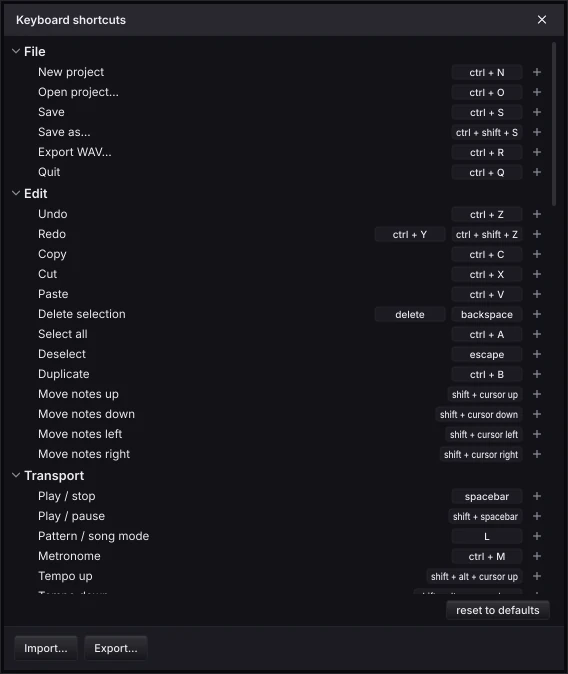

# Juicy Loops Studio

A free, open-source beat-making DAW for Linux, Windows and macOS. If you've made beats in
FL Studio, you already know how to use it: the same Channel Rack, Piano Roll, pattern-based
Playlist and Mixer, the same shortcuts, the same clicks. It runs natively on Linux (ALSA, JACK,
PipeWire; no Wine).


Juicy Loops Studio is an independent project. It is not affiliated with or endorsed by
Image-Line, and it contains no Image-Line code or assets.

## Coming from FL Studio

The workflow is FL's, so there's nothing to relearn:

- **Patterns first.** Program drums on the step sequencer, write melodies in the Piano Roll,
  then paint patterns into the Playlist to build the song. PAT plays the pattern, SONG plays the
  arrangement.
- **The same keys.** F5 Playlist, F6 Channel Rack, F7 Piano Roll, F9 Mixer, Alt+F8 Browser;
  Space to play, L for PAT / SONG, Ctrl+B to duplicate, Ctrl+L for legato, and the typing
  keyboard plays notes from Z (C5 is middle C, as in FL).
- **The same mouse.** Left-click to add steps, notes and clips, right-click to delete them;
  drag the end of a note or clip to resize it; Ctrl+drag to select.
- **The same habits.** Loading a sample renames the channel after it, the Channel Rack floats
  over the Playlist and goes behind it when you click there, patterns can be made unique or split
  by channel, and the mixer's green lights mute and solo.

## Made easier

Small things that save time every session:

- **Scale highlighting is one switch.** In the Piano Roll's title bar, **● Scale**, the key and
  Major / Minor form one control: click the light to show the scale's rows, pick a key and it
  turns on. The scale is saved with the project.
- **Ctrl+Tab moves between windows.** It cycles the keyboard focus through the Browser, Channel
  Rack, Playlist or Piano Roll, Mixer and any open plugin, so the arrow keys and Enter act where
  you're looking. Set it to *Last used first* and it works like Alt+Tab: one press takes you back
  to where you just were.
- **Every action has a shortcut you can change.** FL's keys by default, and every command can
  be rebound, given several keys, or freed, in one window grouped like the menus. A key that's
  already taken asks before it moves. Export your set and import it on another computer; menus
  and tooltips always show your current keys.
- **Audition samples inside the song.** With the song playing, Ctrl+↑ / ↓ in the Browser loads
  the previous or next sample straight into the selected channel, so you hear each kick in the
  beat, not on its own.
- **Short parts loop by themselves.** A 1-bar drum loop under a 4-bar melody keeps repeating
  for the whole pattern; the loop switch at the end of each Channel Rack row turns it off per
  channel.
- **Split by channel keeps the song sounding the same.** Every part keeps the pattern's full
  length and lands on its own Playlist track, in one undo step.

## A look around

**Channel Rack.** Steps for drums, a mini piano roll for melodic channels, and per-channel loop
switches. The current step lights up as the pattern plays.


**Piano Roll.** Velocity lane, snap from beats to none, a slicer for rolls, legato, and the scale
highlight (here C# minor).


**Browser.** Your sample folders, with a waveform and preview for the sample you land on. Use
the arrow keys to move and hear, Enter to load into the selected channel, or drag onto the
Channel Rack or the Playlist (as an audio clip). Previews load in the background, so even long
samples don't hold anything up.

**Sampler.** Every sample channel can follow the tempo: resampled like a record, or
time-stretched with the pitch kept. Pitch, a volume envelope and cut groups (open and closed
hats) are there too.

**Playlist.** Pattern clips and audio clips with waveforms, a picker for patterns and samples,
copy, paste and duplicate, trimming and zoom.

**Plugins.** VST3 and LV2 instruments on channels and effects on mixer inserts. They follow the
tempo and position, so arpeggiators and synced delays stay in time.

<br clear="right">

**Mixer.** 16 inserts with stereo meters, pan and stereo width, mute and solo, and built-in
Filter, EQ, Delay, Reverb, Compressor and Soft Clipper effects.


**Keyboard shortcuts.** Every command, grouped, with its keys; click to change.



## Themes

Seven built-in colour themes: Blackberry (the default), Graphite, Nightshade, Bloodline,
Chrome, Ice and Dracula. Make your own as a small JSON file ([themes.md](docs/themes.md)) and
import it from **Options › Theme…**.


## What's there, and what's not yet

You can make whole beats: steps and piano roll, patterns and arrangement, samples and audio
clips, plugins, mixing with effects, live playing from the computer keyboard or a MIDI keyboard,
projects (`.jlp`) and export to WAV.

Not there yet: recording, automation and mixer sends. See the [roadmap](docs/roadmap.md).

The [user guide](docs/user-guide.md) lists every window, click and shortcut.

## Building

There are no release downloads yet; build it from source.

Requirements: CMake ≥ 3.24, a C++20 compiler (GCC 11+, Clang 14+, MSVC 2022), git.

On Linux you also need the ALSA, JACK, FreeType, fontconfig and X11 development
packages. Ubuntu / Debian: `sudo apt install build-essential cmake ninja-build libasound2-dev
libjack-jackd2-dev libfreetype-dev libfontconfig1-dev libx11-dev libxext-dev libxrandr-dev
libxinerama-dev libxcursor-dev libxcomposite-dev libxi-dev libxrender-dev libgl1-mesa-dev`.
Arch: `sudo pacman -S cmake ninja alsa-lib jack2 freetype2 fontconfig libx11 libxrandr libxinerama libxcursor libxcomposite libxi`

```sh
cmake -B build -G Ninja -DCMAKE_BUILD_TYPE=Debug
cmake --build build
ctest --test-dir build --output-on-failure
```

The app binary ends up under `build/src/app/JuicyLoopsStudio_artefacts/`. To build without
installing anything, use the Docker sandbox (`tools/sandbox.sh`, see
[docs/sandbox.md](docs/sandbox.md)); more in [docs/development.md](docs/development.md).

## Contributing

People and AI agents alike: start with [AGENTS.md](AGENTS.md), then the
[docs](docs/README.md).

## License

AGPLv3. See [LICENSE](LICENSE). This follows from JUCE's open-source license.
