# Juicy Loops Studio

A free, open-source beat-making DAW for Linux, Windows and macOS. If you've made beats in
FL Studio, you already know how to use it: the same Channel Rack, Piano Roll, pattern-based
Playlist and Mixer, the same shortcuts, the same clicks. It runs natively on Linux (ALSA, JACK,
PipeWire; no Wine).

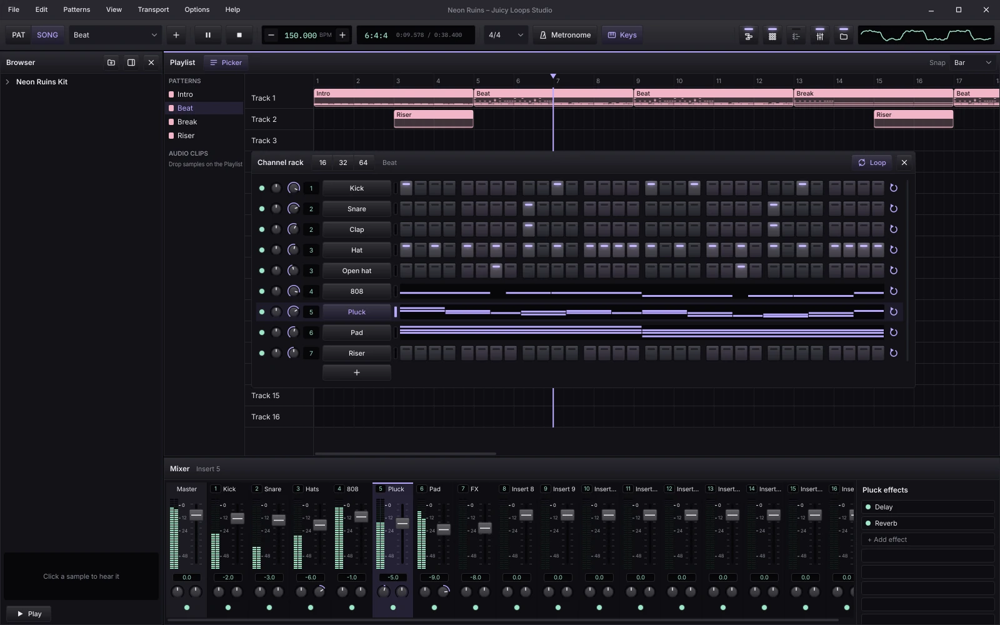

> Juicy Loops Studio is an independent project. It is not affiliated with, endorsed by or
> connected to Image-Line, and it contains no Image-Line code or assets. FL Studio is a
> trademark of Image-Line; it's named here only to describe the workflow.

## Coming from FL Studio

The workflow is FL's, so there's nothing to relearn:

- Program drums on the step sequencer, write melodies in the Piano Roll, then paint patterns
  into the Playlist to build the song. PAT plays the pattern, SONG plays the arrangement.
- The keys are the ones you know: F5 Playlist, F6 Channel Rack, F7 Piano Roll, F9 Mixer, Alt+F8
  Browser, Space to play, L for PAT / SONG, Ctrl+B to duplicate, Ctrl+L for legato. The typing
  keyboard plays notes from Z, and C5 is middle C.
- The mouse works the same way: left-click adds steps, notes and clips, right-click deletes
  them, dragging an end resizes, Ctrl+drag selects.
- The habits carry over too. Loading a sample renames the channel after it, the Channel Rack
  floats over the Playlist and goes behind it when you click there, patterns can be made unique
  or split by channel, and the mixer's green lights mute and solo.

## Made easier

Small things that save time every session.

### Scale highlighting in one click

The scale switch, the key and the mode sit together in the Piano Roll's title bar. Click the
light to show the scale's rows; pick a key and it turns on. The project remembers it.

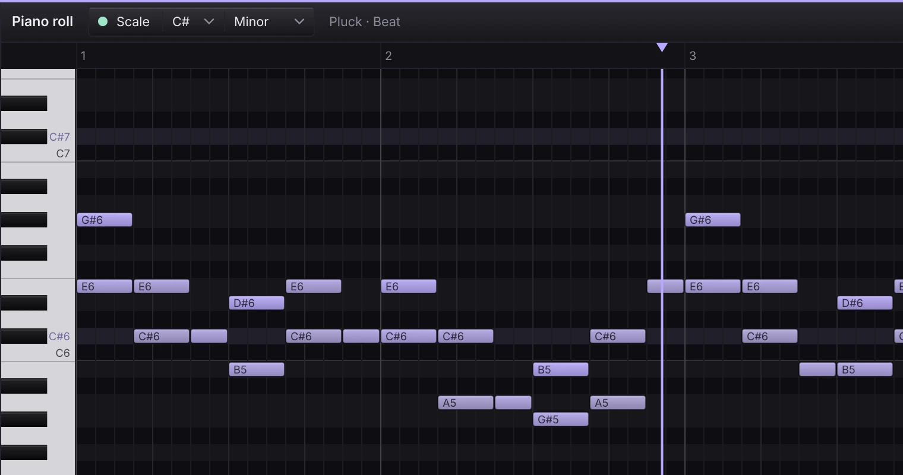

### Ctrl+Tab between windows

Ctrl+Tab moves the keyboard focus through the Browser, Channel Rack, Playlist or Piano Roll,
Mixer and any open plugin, so the arrow keys and Enter act where you're looking. Set the order
to *Last used first* and it works like Alt+Tab: one press takes you back to where you just were.

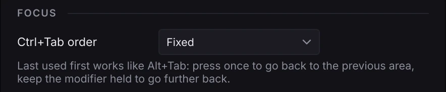

### Shortcuts you can change

FL's keys come by default, and every command can be rebound, given several keys or freed. A key
that's already taken asks before it moves. Export your set and import it on another computer;
menus and tooltips always show your current keys.

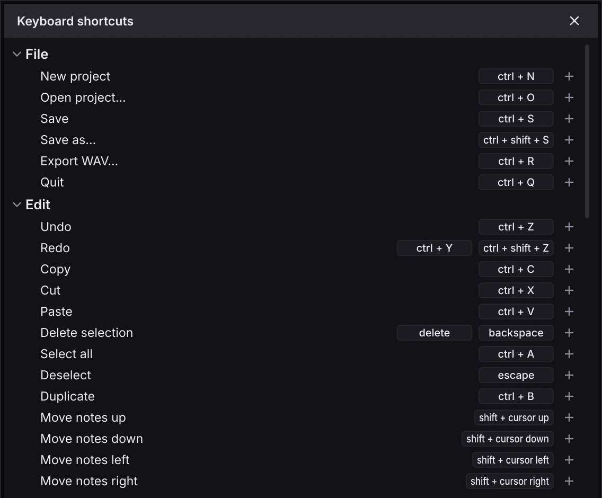

### Audition samples inside the song

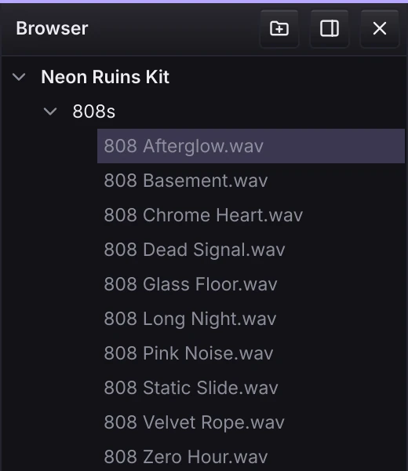

While the song plays, Ctrl+↑ / ↓ in the Browser loads the previous or next sample straight
into the selected channel. You hear each 808 in the beat instead of on its own, and keep the one
that fits.

Clicking a sample or landing on it with the arrow keys previews it and draws its waveform.
Previews load in the background, so even long samples don't hold anything up.

<br clear="right">

### Short parts loop by themselves

A 2-bar drum loop under a 4-bar melody keeps repeating for the whole pattern; the greyed steps
show the repeat. Each Channel Rack row has its own loop switch to turn that off.

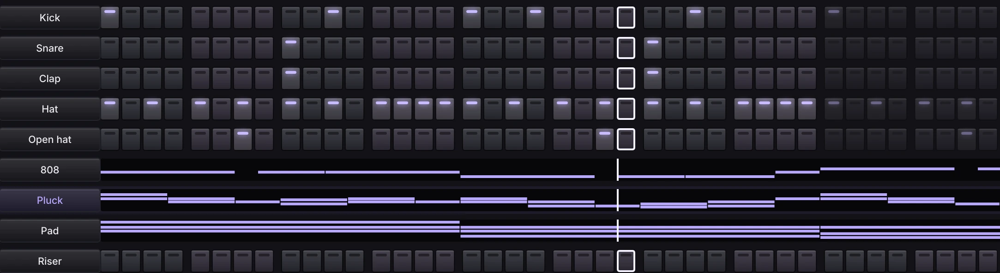

### Split by channel lays out the parts for you

Each channel's part gets its own Playlist track, right under the original clip and with nothing
overlapping, so the arrangement stays tidy and ready to edit.

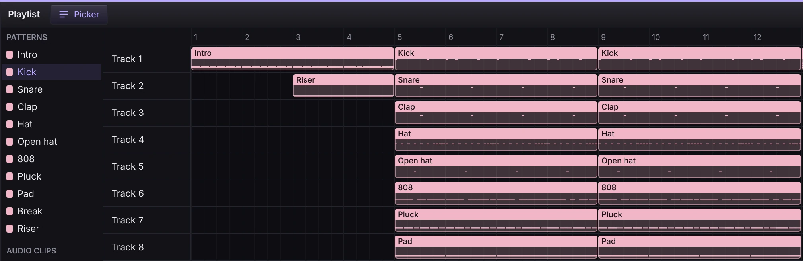

## A look around

### Channel Rack

Steps for drums, a mini piano roll for melodic channels, and a loop switch on every row. The
current step lights up as the pattern plays.

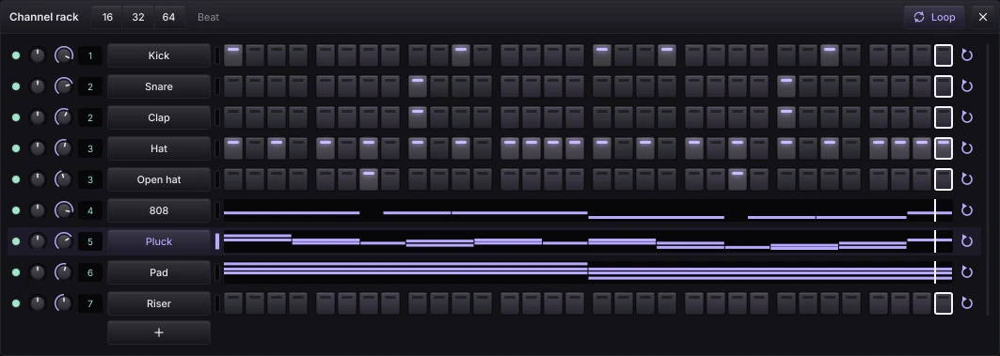

### Piano Roll

A velocity lane, snap from beats down to none, a slicer for rolls, legato, and the scale
highlight.

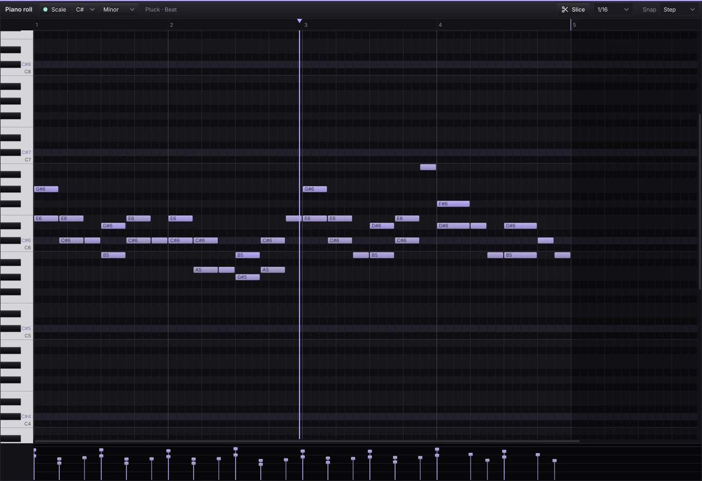

### Browser and Sampler

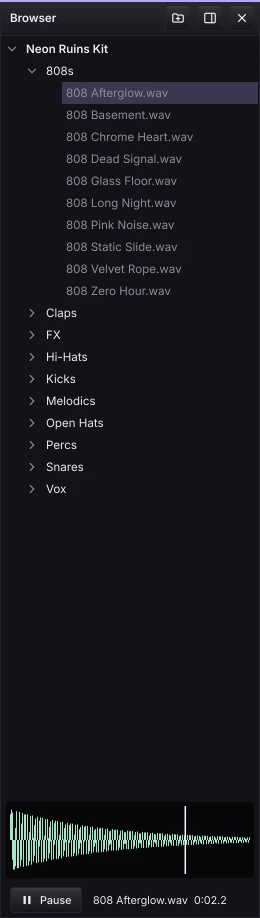

The Browser lists your sample folders. Move through them with the arrow keys and hear each
sample, press Enter to load one into the selected channel, or drag it onto the Channel Rack or
the Playlist.

Every sample channel has a Sampler. It can follow the tempo, resampled like a record or
time-stretched with the pitch kept, and it has pitch, a volume envelope, and cut groups for
open and closed hats.

<br clear="right">

### Playlist

Pattern clips and audio clips with waveforms, a picker for patterns and samples, copy, paste
and duplicate, trimming and zoom.

### Mixer

16 inserts with stereo meters, pan and stereo width, mute and solo, and built-in Filter, EQ,
Delay, Reverb, Compressor and Soft Clipper effects.

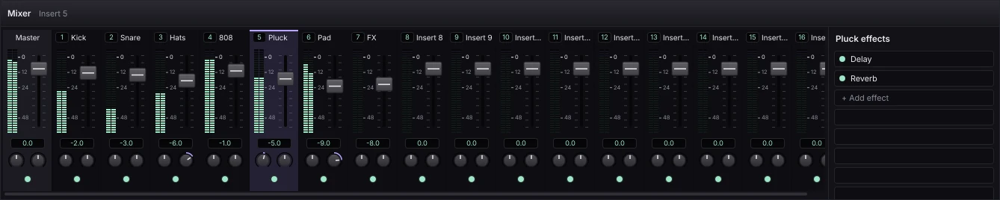

### Plugins

VST3 and LV2 instruments on channels and effects on mixer inserts. They follow the tempo and
position, so arpeggiators and synced delays stay in time.

## Themes

Seven built-in colour themes: Blackberry (the default), Graphite, Nightshade, Bloodline,
Chrome, Ice and Dracula. Make your own as a small JSON file ([themes.md](docs/themes.md)) and
import it from **Options › Theme…**.

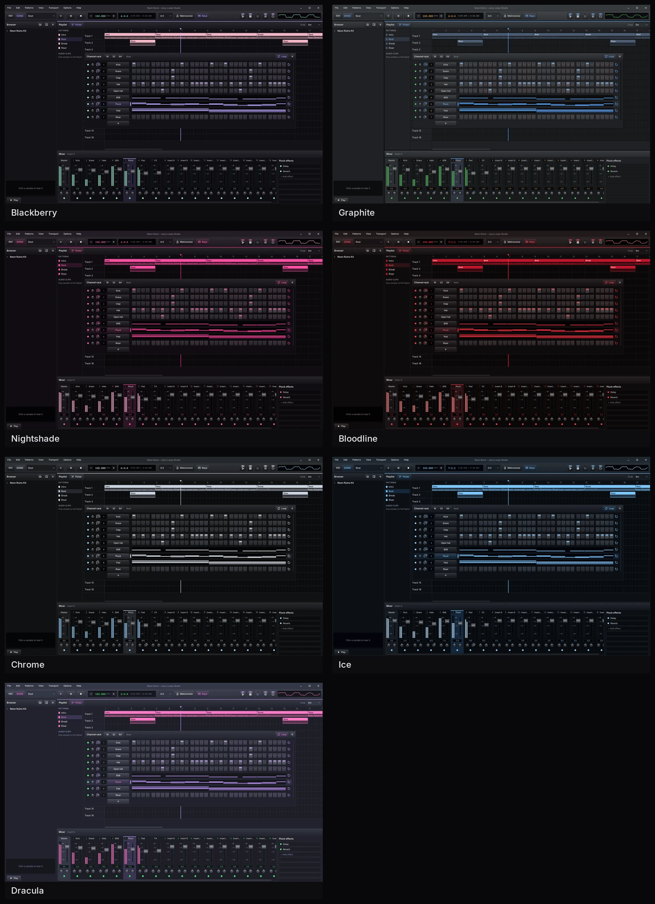

## What's there, and what's not yet

You can make whole beats: steps and piano roll, patterns and arrangement, samples and audio
clips, plugins, mixing with effects, live playing from the computer keyboard or a MIDI keyboard,
projects (`.jlp`) and export to WAV.

Not there yet: recording, automation and mixer sends. See the [roadmap](docs/roadmap.md).

The [user guide](docs/user-guide.md) lists every window, click and shortcut.

## Building from source

There are no downloads yet, so for now you build it yourself. It takes a few minutes, mostly
compiling JUCE the first time.

### 1. Get the tools

You need git, CMake 3.24 or newer and a C++20 compiler: GCC 11+, Clang 14+ or Visual Studio
2022.

On Linux, install the audio and graphics libraries too:

```sh
# Ubuntu / Debian
sudo apt install build-essential cmake ninja-build git libasound2-dev libjack-jackd2-dev \
    libfreetype-dev libfontconfig1-dev libx11-dev libxext-dev libxrandr-dev libxinerama-dev \
    libxcursor-dev libxcomposite-dev libxi-dev libxrender-dev libgl1-mesa-dev

# Arch
sudo pacman -S base-devel cmake ninja git alsa-lib jack2 freetype2 fontconfig libx11 \
    libxrandr libxinerama libxcursor libxcomposite libxi
```

On Windows, install Visual Studio 2022 with *Desktop development with C++*, which includes
CMake. On macOS, install the Xcode command line tools and CMake (`brew install cmake`).

### 2. Build

```sh
git clone https://github.com/rohalrafael/juicy-loops-studio.git
cd juicy-loops-studio
cmake -B build -DCMAKE_BUILD_TYPE=Release
cmake --build build --config Release --parallel
```

### 3. Run

The app is in `build/src/app/JuicyLoopsStudio_artefacts/Release/`: `Juicy Loops Studio` on
Linux, `Juicy Loops Studio.exe` on Windows, `Juicy Loops Studio.app` on macOS. Give it a
project file to open it right away:

```sh
"build/src/app/JuicyLoopsStudio_artefacts/Release/Juicy Loops Studio" song.jlp
```

### Tests

```sh
ctest --test-dir build -C Release --output-on-failure
```

### Without installing anything

On Linux with Docker, `tools/sandbox.sh` gives you a container with every tool, library and
test plugin already in it ([sandbox.md](docs/sandbox.md)). More on building, testing and the
UI tests in [development.md](docs/development.md).

## Contributing

People and AI agents alike: start with [AGENTS.md](AGENTS.md), then the
[docs](docs/README.md).

## License

AGPLv3. See [LICENSE](LICENSE). This follows from JUCE's open-source license.

Juicy Loops Studio is not affiliated with or endorsed by Image-Line. FL Studio is a trademark
of Image-Line.
